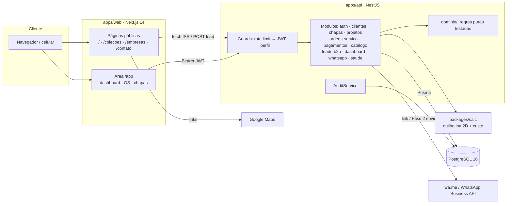
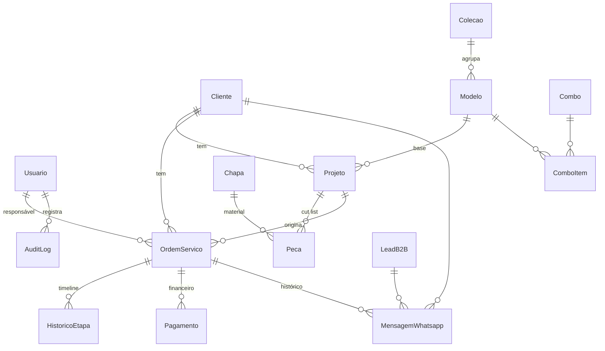

# Arquitetura — Sistema Arquijo Marmoraria e Marcenaria

> Documento NEXUS · MVP Fase 1 · versão 0.1.0 · outubro/2026
> Fonte dos requisitos: *Prompt Mestre Consolidado v4.0* (RF01–RF24, RNF01–RNF07).

## 1. Objetivo

Sistema ponta a ponta para uma marcenaria e marmoraria de móveis planejados no Rio de Janeiro: do primeiro contato (Google, site, WhatsApp) até o recebimento do valor. O MVP resolve as dores principais:

| Dor atual | Como o sistema resolve |
|---|---|
| Chapa calculada "na cabeça", erro de 1–2 folhas por projeto | Motor guilhotina 2D (`packages/calc`) com serra, veio, sobras e estoque vs compra |
| Cada orçamento do zero | Catálogo de coleções, 8 modelos e combos (seed) + prévia de custo automática |
| Sem venda profissional para empresas | Landing `/empresas`, formulário B2B, calculadora de volume, CRM de leads |
| OS sem prazo e prioridade | Kanban de 9 etapas, prioridade, prazo acordado × real, atraso e histórico |
| Sem controle até o recebimento | Financeiro por OS (entrada 50% + saldo), fluxo de caixa e dashboard |

**Dados institucionais** (Módulo H): Arquijo Marmoraria e Marcenaria · R. Mupia, Rio de Janeiro - RJ, 21220-320 · +55 21 98450-3570 · Seg–Dom 08:00–20:00 · Place ID 604870052287207 · -22.848012, -43.318048.

### Premissas assumidas
1. Equipe interna pequena (até ~15 usuários), uma única empresa (sem multi-tenant no MVP).
2. WhatsApp na Fase 1 é por link `wa.me` (o atendente clica e envia); envio automático só com a Business API (Fase 2).
3. Valores em reais com 2 casas; medidas em milímetros; fuso `America/Sao_Paulo`.
4. Fotos ficam como URLs (campos `String[]`); upload para S3 entra na Fase 2.
5. O cálculo de chapas é uma **previsão**: não baixa o estoque automaticamente (a baixa é um ajuste explícito em `POST /chapas/:id/estoque`).

### Perguntas a validar com o cliente
- Faixas de desconto B2B (5/10/15/20/25%) e regra de prazo (20 dias + 5 a cada 10 unidades) estão corretas?
- Preço padrão da fita de borda (R$ 2,50/m) e valor-hora de mão de obra.
- Quem pode ver CPF/CNPJ de clientes (hoje: GESTOR e COMERCIAL).
- Política de retenção de dados de leads não convertidos (proposta: 24 meses).

## 2. Usuários, perfis e permissões

| Perfil | Quem é | Pode |
|---|---|---|
| **ADMIN** | Dono / TI | Tudo, inclusive criar usuários (`POST /auth/usuarios`). Passa em qualquer guard. |
| **GESTOR** | Gerente da marcenaria | Dashboard, financeiro, chapas (CRUD), OS (CRUD e exclusão), clientes (inclui anonimização LGPD), leads |
| **COMERCIAL** | Vendas / atendimento | Clientes, projetos, OS (criar/editar/avançar), pagamentos (registrar/confirmar), leads B2B, WhatsApp |
| **MARCENEIRO** | Produção e obra | Ver OS e chapas, avançar etapa da OS, ajustar estoque, projetos/cut list e cálculo |
| Público | Visitante do site | Catálogo, quiz, calculadora B2B, enviar lead, link oficial do WhatsApp |

Implementação: três guards globais em ordem — `ThrottlerGuard` → `JwtAuthGuard` (tudo exige JWT, salvo `@Publico()`) → `PerfisGuard` (`@Perfis(...)`). Negar por padrão: rota nova sem decorator exige login.

## 3. Requisitos funcionais → módulos/endpoints

| RF | Descrição | Onde | Status MVP |
|---|---|---|---|
| RF01 | Cadastro de chapas com tamanho fixo e estoque | `chapas` · `GET/POST/PATCH/DELETE /chapas`, `POST /chapas/:id/estoque` | ✅ |
| RF02 | Peças do projeto (L×A×Qtd, material, veio) | `projetos` · `POST /projetos`, `PUT /projetos/:id/pecas` | ✅ |
| RF03 | Cálculo de chapas com aproveitamento e desperdício | `@arquijo/calc` + `POST /projetos/:id/calcular` | ✅ |
| RF04 | Plano de corte 2D por chapa | resposta de `/calcular` (`planos[].pecas[x,y,largura,altura]`, `sobras`) | ✅ dados · ⏳ desenho (web) |
| RF05 | Prévia de gasto (MDF + fita + ferragens + mão de obra + margem) | `calcularPreviaCusto` + `/calcular` (`previa`) | ✅ |
| RF06 | Lista de compra vs estoque | `/calcular` (`listaCompra`, `qtdDoEstoque`, `qtdCompra`) | ✅ |
| RF07 | Coleções Essencial/Moderna/Premium | `GET /catalogo/colecoes[/:slug]` + seed | ✅ |
| RF08 | Modelos por ambiente com fotos e preço | `GET /catalogo/modelos[/:slug]` (+ link "Quero este modelo") | ✅ (fotos: URLs) |
| RF09 | Quiz de sugestão | `POST /catalogo/quiz` (`dominio/quiz.ts`) | ✅ API |
| RF10 | Combos prontos | `GET /catalogo/combos` + seed (3 combos) | ✅ |
| RF11 | OS com 9 status e Kanban | `GET /ordens-servico/kanban`, `PATCH /ordens-servico/:id/avancar` | ✅ API · ⏳ tela |
| RF12 | Prioridade com cor | enum `PrioridadeOS`; cor no front | ✅ |
| RF13 | Prazo acordado, prazo real, atraso | `prazoAcordado`, `prazoReal` (setado ao entrar em ENTREGA), `atrasoDias` | ✅ |
| RF14 | Timeline da OS | `GET /ordens-servico/:id` → `timeline[]` com horas por etapa (HistoricoEtapa) | ✅ API |
| RF15 | Financeiro por OS, entrada 50% e saldo | `pagamentos` · `POST /pagamentos/plano-padrao/:osId`, `PATCH /pagamentos/:id/confirmar` | ✅ |
| RF16 | Dashboard funil ponta a ponta | `GET /dashboard/funil` | ✅ API |
| RF17 | Gantt de prazos por prioridade | `GET /ordens-servico/gantt` | ✅ API · ⏳ tela |
| RF18 | Fluxo de caixa (recebido, a receber, atraso) | `GET /dashboard/fluxo-caixa` | ✅ |
| RF19 | WhatsApp em todo o sistema | `POST /whatsapp/link` (contextual), `GET /whatsapp/oficial`, botão flutuante no site | ✅ |
| RF20 | Histórico WhatsApp por OS | `MensagemWhatsapp` + `GET /whatsapp/historico?ordemServicoId=` | ✅ |
| RF21 | Portfólio "Como fiz" em 6 etapas | `ObraPortfolio.etapas` + `GET /catalogo/obras[/:slug]` | ✅ API (CRUD interno: Fase 2) |
| RF22 | Prospecção B2B (formulário, calculadora, CRM, proposta PDF) | `POST /leads-b2b`, `POST /leads-b2b/simular`, `GET /leads-b2b/kanban`, `PATCH /leads-b2b/:id/status` | ✅ (PDF: Fase 2) |
| RF23 | Google Maps e Place ID | `GET /catalogo/empresa`, página `/contato` com links Maps/rota | ✅ links · ⏳ mapa embarcado |
| RF24 | Exportação PDF (orçamento, OS, proposta, lista de compra) | — | ⏳ Fase 2 |

## 4. Requisitos não funcionais

| RNF | Meta | Como é atendido | Evidência |
|---|---|---|---|
| RNF01 | Cálculo < 2s para 50 peças | Algoritmo O(n·r) em memória, sem I/O; teste automatizado | Teste "50 peças em menos de 2s" (Vitest); chamada real ao endpoint: 1,5 ms de cálculo |
| RNF02 | Plano de corte visual < 1s | Coordenadas prontas no JSON; front só desenha SVG | ⏳ medir quando a tela existir |
| RNF03 | PWA offline para medição | Fase 2: service worker + IndexedDB, sincronização ao reconectar | ⏳ |
| RNF04 | WhatsApp < 5s | Link `wa.me` gerado localmente (ms); Business API com fila na Fase 2 | ✅ |
| RNF05 | 100 projetos simultâneos | API stateless (JWT), índices em status/prazo/cliente, pool do Prisma; escala horizontal no Railway/Render | ⏳ teste de carga (k6) |
| RNF06 | LGPD | Consentimento com data/origem, anonimização na exclusão, auditoria, mínimo de dados no lead, CORS restrito | ✅ |
| RNF07 | Branding dinâmico | Cores da marca em variáveis CSS (`--cor-marca`) consumidas pelo Tailwind | ✅ |

## 5. Arquitetura



**Monorepo (npm workspaces, TypeScript estrito):**

```
arquijo/
├─ packages/calc/        motor puro (sem dependências de runtime) + testes Vitest
├─ apps/api/             NestJS + Prisma (schema, migrações, seed) + testes de domínio
│  └─ src/{common,config,dominio,modulos,prisma}
├─ apps/web/             Next.js 14 App Router + Tailwind
├─ docs/arquitetura.md   este documento
├─ docker-compose.yml    postgres + api + web
└─ .env.example          placeholders (SECRET_KEY_AQUI, DB_PASSWORD, TOKEN_AQUI...)
```

Decisões-chave:
- **Motor de cálculo isolado e puro**: testável sem banco, reutilizável no navegador/PWA offline (RNF03) e em worker (PQueue) se necessário.
- **Regras de negócio puras em `apps/api/src/dominio`** (fluxo de OS, atraso, status financeiro, WhatsApp, CNPJ, quiz, B2B, funil, fluxo de caixa): testadas com Vitest; serviços Nest só orquestram I/O.
- **Snapshot do cálculo** salvo em `Projeto.resultadoCalculo` e em `OrdemServico.materiais` — a OS guarda os materiais do momento da criação, mesmo que a cut list mude depois.
- **Avanço de etapa com update condicional** (`WHERE id AND status = atual`) dentro de transação → sem avanço duplo concorrente.

### Algoritmo de chapas (resumo)
1. Valida peças (medidas > 0, quantidade inteira ≥ 1) e agrupa por chapa/material.
2. Expande pela quantidade e ordena por área decrescente.
3. Para cada peça: *first fit* entre chapas abertas, *best short side fit* entre os retângulos livres da chapa; testa rotação só se `veio = false`.
4. Ao posicionar, faz corte guilhotina descontando a serra (padrão 4 mm) e escolhe o corte (horizontal/vertical) que deixa o maior retalho.
5. Não coube numa chapa nova → `PecaMaiorQueChapaError` com mensagem clara (HTTP 422).
6. Resultado: chapas usadas, posições, aproveitamento/desperdício %, sobras ≥ 300×300 mm, estoque vs compra e custo. `estimativaPorArea` (área × 1,15) fica como conferência rápida.

## 6. Modelo de dados



| Entidade | Campos principais | Índices / restrições | Soft delete |
|---|---|---|---|
| Usuario | nome, email (único), senhaHash (bcrypt 12), perfil, ativo, ultimoLoginEm | `email` único, `perfil` | sim |
| Cliente | nome, telefone, email, documento, bairro, tipo, **consentimentoLgpd/Em/Origem** | `nome`, `telefone`, `deletadoEm` | sim + anonimização |
| Chapa | nome, material, larguraMm, alturaMm, espessuraMm, qtdEstoque, custoUnitario, fornecedor | único (material, espessura, largura, altura) | sim |
| Projeto | nome, ambiente, clienteId, modeloId, espessuraSerraMm, parâmetros de custo, ferragens (JSON), resultadoCalculo, previaCusto | `clienteId`, `status` | sim |
| Peca | projetoId, chapaId, nome, larguraMm, alturaMm, quantidade, veio | `projetoId`, `chapaId`; cascade com projeto; restrict com chapa | — |
| OrdemServico | numero (seq. a partir de 101 → "OS-101"), clienteId, projetoId, status (9), prioridade (4), datas, prazoAcordado, prazoReal, valorTotal, valorEntrada, valorRecebido, statusFinanceiro, materiais (JSON) | (`status`,`prioridade`), `prazoAcordado`, `clienteId`, `responsavelId` | sim |
| HistoricoEtapa | ordemServicoId, de, para, entrouEm, saiuEm, usuarioId, observacao | (`ordemServicoId`,`entrouEm`) | — |
| Pagamento | ordemServicoId, tipo (ENTRADA/PARCELA), forma (PIX/CARTAO/PARCELADO), valor, parcelas, status, vencimento, pagoEm | `ordemServicoId`, (`status`,`vencimento`), `pagoEm` | cancelamento lógico |
| MensagemWhatsapp | telefone, mensagem, link, direção, canal, status, contexto, FKs opcionais | (`ordemServicoId`,`criadoEm`), (`clienteId`,`criadoEm`) | — |
| Colecao / Modelo / Combo / ComboItem | catálogo público; preço `null` = sob consulta | `slug` único | `ativo` |
| LeadB2B | tipo, nomeEmpresa, cnpj (dígitos), responsável, whatsapp, unidades, prazo, bairro, orçamento, precisaMedicao, status CRM, consentimentoLgpd | `status`, `cnpj`, `criadoEm` | sim |
| ObraPortfolio | título, bairro, tipoCliente, desafio, solução, materiais[], etapas (6, JSON), fotos[], depoimento, publicado | `slug` único, `publicado`, `tipoCliente` | sim |
| AuditLog | usuarioId, ação, entidade, entidadeId, dados (JSON), ip, userAgent | (`entidade`,`entidadeId`), (`usuarioId`,`criadoEm`), `criadoEm` | nunca apaga |

Migrações versionadas em `apps/api/prisma/migrations` (`inicial` + `os_numero_inicia_101`). Seed idempotente: 3 coleções, 8 modelos, 3 combos, 6 chapas, 1 obra de portfólio, admin (+ demo opcional com a cut list do PDF).

## 7. Endpoints (REST, JSON, Swagger em `/docs`)

Público = sem JWT. Demais exigem `Authorization: Bearer <token>`.

| Método e rota | Perfis | Descrição |
|---|---|---|
| `GET /saude` | público | Health check (inclui `SELECT 1`) |
| `POST /auth/login` | público (5/min) | Login → `accessToken` (JWT 8h) |
| `GET /auth/me` | todos | Usuário logado |
| `GET /auth/usuarios` · `POST /auth/usuarios` | GESTOR · ADMIN | Listar · criar usuário |
| `GET/POST /clientes`, `GET/PATCH /clientes/:id` | GESTOR, COMERCIAL | CRUD com busca e paginação |
| `DELETE /clientes/:id` | GESTOR | Anonimização LGPD |
| `GET /chapas`, `GET /chapas/:id` | todos | Chapas e estoque |
| `POST/PATCH/DELETE /chapas[/:id]` | GESTOR | Cadastro |
| `POST /chapas/:id/estoque` | GESTOR, MARCENEIRO | Entrada/baixa atômica auditada |
| `GET/POST /projetos`, `GET/PATCH /projetos/:id` | GESTOR, COMERCIAL, MARCENEIRO | Projetos com cut list |
| `PUT /projetos/:id/pecas` | idem | Substitui a cut list |
| `POST /projetos/:id/calcular` | idem | Plano de corte + prévia + lista de compra |
| `DELETE /projetos/:id` | GESTOR | Soft delete |
| `GET /ordens-servico` (`status`, `prioridade`, `atrasadas`, `responsavelId`) | todos | Lista com `codigo`, `atrasoDias` |
| `GET /ordens-servico/kanban` · `/gantt` · `/:id` | todos | Kanban 9 colunas · Gantt · detalhe com timeline |
| `POST /ordens-servico` · `PATCH /ordens-servico/:id` | GESTOR, COMERCIAL | Criar (calcula chapas se `projetoId`) · editar |
| `PATCH /ordens-servico/:id/avancar` | GESTOR, COMERCIAL, MARCENEIRO | Próxima etapa + HistoricoEtapa |
| `DELETE /ordens-servico/:id` | GESTOR | Soft delete |
| `GET/POST /pagamentos` | GESTOR, COMERCIAL | Listar (por OS) · registrar |
| `POST /pagamentos/plano-padrao/:osId` | idem | Entrada 50% + saldo |
| `PATCH /pagamentos/:id/confirmar` · `/:id/cancelar` | idem · GESTOR | Baixa · cancelamento |
| `GET /catalogo/empresa|colecoes|colecoes/:slug|modelos|modelos/:slug|combos|obras|obras/:slug` | público | Catálogo e portfólio |
| `POST /catalogo/quiz` | público | Sugestão de coleções |
| `POST /leads-b2b` | público (5/10 min) | Lead B2B com CNPJ válido, LGPD e honeypot |
| `POST /leads-b2b/simular` | público (30/min) | Calculadora de volume |
| `GET /leads-b2b` · `/kanban` · `PATCH /leads-b2b/:id/status` | GESTOR, COMERCIAL | CRM |
| `GET /dashboard` · `/kpis` · `/funil` · `/fluxo-caixa` · `/atencao-hoje` | GESTOR | Painel ponta a ponta |
| `GET /whatsapp/oficial` | público | Link oficial |
| `POST /whatsapp/link` | todos | Link `wa.me` contextual (OS, cliente, lead, projeto, livre) + log |
| `GET /whatsapp/historico` | todos | Histórico por OS/cliente/lead |

Erros: 400 validação (class-validator, `whitelist` + `forbidNonWhitelisted`), 401 sem token, 403 perfil, 404, 409 conflito de etapa, 422 erro do motor de cálculo, 429 rate limit.

## 8. Segurança e LGPD

| Controle | Implementação |
|---|---|
| Autenticação | JWT HS256 com `issuer`, expiração configurável (8h); segredo validado na subida (≥ 32 caracteres e sem placeholder em produção) |
| Senhas | bcrypt (bcryptjs, 12 rodadas); política mínima (10+ caracteres, letras e números); comparação com hash fictício quando o e-mail não existe (sem vazamento por tempo) |
| Autorização | RBAC por perfil com guard global; negar por padrão |
| Força bruta / abuso | Rate limit global 120/min; login 5/min; lead 5/10 min; honeypot no formulário |
| Injeção | Prisma (consultas parametrizadas); nenhuma SQL concatenada |
| XSS | React escapa por padrão; API só JSON; `helmet` (CSP, HSTS, noSniff...) e cabeçalhos de segurança no Next |
| CSRF | API stateless com Bearer token (sem cookie de sessão). Ao migrar o token para cookie httpOnly no front, usar `SameSite=Strict` + token anti-CSRF |
| Validação | DTOs com class-validator em todas as entradas; corpo limitado a 1 MB; UUIDs validados em parâmetros |
| CORS | Lista de origens por variável `CORS_ORIGINS` |
| Segredos | Somente via variáveis de ambiente; `.env` no `.gitignore`; `.env.example` com placeholders |
| Auditoria | `AuditLog` em login (sucesso/falha), usuário, cliente (criação, consentimento, anonimização), chapa (cadastro, estoque), projeto (cálculo), OS (criar, editar, avançar, remover), pagamentos, leads, WhatsApp de OS |
| Containers | Usuário não-root (`node`), Postgres exposto só em 127.0.0.1 |

**LGPD (RNF06):**
- Base legal: consentimento (lead, cliente) e execução de contrato (OS/financeiro).
- Consentimento registrado com data e origem; o formulário B2B só aceita com `consentimentoLgpd = true`.
- Direito de eliminação: `DELETE /clientes/:id` anonimiza nome, telefone, e-mail, documento e endereço, preservando OS/pagamentos para obrigação fiscal.
- Minimização: resposta do lead público não devolve dados pessoais; logs de auditoria não guardam senha nem corpo completo.
- A fazer (Fase 2): exportação dos dados do titular, política de retenção automática de leads, criptografia de coluna para `documento`, encarregado (DPO) e política de privacidade publicada.

## 9. Integrações

| Integração | Fase 1 (MVP) | Fase 2 | Autenticação | Falhas / contingência |
|---|---|---|---|---|
| **WhatsApp** | `wa.me/<número>?text=<encodeURIComponent>` gerado pela API (`LinkWaMeProvider`) com mensagem contextual e log em `MensagemWhatsapp`; botão flutuante no site | `BusinessApiProvider` (Cloud API da Meta): templates aprovados, fila com retentativa exponencial, webhook de status/recebidas, idempotência por id da mensagem | Token de sistema (`WHATSAPP_API_TOKEN`) + `WHATSAPP_PHONE_NUMBER_ID` | Sem credencial → 503 claro; volta para link `wa.me` |
| **Google Meu Negócio / Maps** | Links oficiais (perfil, busca por coordenadas, rota) e Place ID em `/contato` e `GET /catalogo/empresa` | Mapa embarcado/estático com `GOOGLE_MAPS_API_KEY` restrita por domínio; nota/estrelas via Places API | API key restrita | Sem chave → mantém links |
| **S3 (fotos)** | URLs em `String[]` | Upload com URL pré-assinada, bucket privado + CDN | IAM com menor privilégio | — |

Troca de provedor WhatsApp só por variável (`WHATSAPP_PROVIDER=link|business_api`), sem mudar código dos módulos.

## 10. Deploy, backup e monitoramento

**Deploy**
- Local: `docker compose up -d --build` (postgres + api + web). A API aplica `prisma migrate deploy` ao subir.
- Produção recomendada: Railway ou Render — API e Web como serviços Docker, PostgreSQL gerenciado, HTTPS automático, domínio próprio (ex.: `arquijo.com.br` / `api.arquijo.com.br`).
- Variáveis obrigatórias: `DATABASE_URL`, `JWT_SECRET`, `CORS_ORIGINS`, `NEXT_PUBLIC_API_URL`.

**Backup**
- Postgres gerenciado com backup diário e PITR (Railway/Render) **ou** `pg_dump` diário via cron para bucket S3 com retenção de 30 dias (diário) + 12 meses (mensal).
- Teste de restauração mensal em banco de homologação (backup não testado não é backup).
- RPO alvo 24h (Fase 1) → 5 min com PITR; RTO alvo 4h.

**Monitoramento**
- `GET /saude` para health check do orquestrador e uptime externo (UptimeRobot/BetterStack).
- Logs estruturados do Nest no agregador da plataforma; alertas para 5xx e picos de 401/429.
- Fase 2: Sentry (erros API/Web), métricas de tempo do `/calcular` (já devolvido em `duracaoMs`).

## 11. Matriz de decisão da stack

Pesos NEXUS: Performance 25 · Robustez 20 · Segurança 15 · Simplicidade 15 · Escalabilidade 10 · Custo 10 · Manutenção 5. Notas de 1 a 5.

| Opção | Perf. | Rob. | Seg. | Simpl. | Escal. | Custo | Man. | **Total** |
|---|---|---|---|---|---|---|---|---|
| **NestJS + Prisma + PostgreSQL + Next.js (escolhida, PDF)** | 4 | 5 | 5 | 3 | 4 | 4 | 5 | **4,25** |
| Next.js full-stack (route handlers) + Prisma | 4 | 3 | 4 | 5 | 3 | 5 | 3 | 3,90 |
| FastAPI + SQLAlchemy + Next.js | 4 | 4 | 4 | 3 | 4 | 4 | 3 | 3,80 |
| Supabase (BaaS) + Next.js | 4 | 3 | 4 | 4 | 4 | 3 | 3 | 3,65 |

Justificativa: Nest dá módulos, DI, guards e Swagger prontos para um domínio com muitas regras (OS, financeiro, RBAC, auditoria); TypeScript de ponta a ponta permite **compartilhar o motor de cálculo** entre API, web e PWA. PostgreSQL cobre JSON (snapshots), arrays e transações. A opção full-stack Next seria mais simples, mas mistura domínio e UI e dificulta a futura integração com WhatsApp/webhooks.

## 12. Riscos e mitigação

| Risco | Prob. | Impacto | Mitigação |
|---|---|---|---|
| Heurística guilhotina não ser ótima (pode usar 1 chapa a mais que um otimizador) | média | médio | Testes de regressão; comparar com `estimativaPorArea`; Fase 3: busca com várias ordenações/heurísticas e escolher a melhor |
| Vulnerabilidades conhecidas em dependências (npm audit: 13 em produção, incl. `next` 14 e `@nestjs/*` 10; correções exigem versões maiores) | alta | alto | **Antes de produção**: atualizar para NestJS 11+ e Next 15+ (o PDF fixa Next 14), rodar testes e build; Dependabot/Renovate |
| WhatsApp Business API exige aprovação da Meta e templates | média | médio | Fase 1 funciona 100% com `wa.me`; provider plugável |
| Dados pessoais vazarem (LGPD) | baixa | alto | RBAC, auditoria, anonimização, HTTPS, backups criptografados |
| Área interna web ainda sem login/telas | alta | médio | API completa e documentada; prioridade nº 1 da continuação |
| Fotos reais e conteúdo do portfólio inexistentes | alta | baixo | Campos prontos; carga de conteúdo na Fase 2 |
| Dependência de fornecedor único de hospedagem | baixa | médio | Tudo em Docker; migração para VPS/AWS sem mudança de código |

## 13. Plano de execução por fases

**Fase 1 — MVP (este repositório)**
- ✅ Motor de chapas + prévia de custo com testes
- ✅ API: auth/RBAC, clientes, chapas, projetos/cálculo, OS (Kanban, etapas, atraso, Gantt), pagamentos, catálogo, B2B, dashboard, WhatsApp link, auditoria, Swagger
- ✅ Banco com migrações e seed do PDF
- ✅ Site público (home, coleções, empresas com formulário, contato) e esqueleto `/app`
- ⏳ Concluir na Fase 1: login no front (cookie httpOnly), telas Kanban de OS, cadastro de chapas e cut list com plano de corte em SVG, dashboard visual; atualização de dependências

**Fase 2 — Operação completa** (alinhada aos "Próximos passos" do PDF)
- Unir tudo em site único (domínio `arquijo.com.br`), fotos reais das obras da R. Mupia, upload S3
- Cálculo integrado à OS no front (já automático na API ao criar OS a partir de projeto)
- Página `/empresas` divulgada para imobiliárias; proposta comercial B2B em PDF
- WhatsApp Business API: envio automático de atualização de etapa da OS, webhook de respostas
- Exportação PDF/CSV (orçamento, OS, lista de compra, relatório financeiro) — RF24
- PWA do marceneiro: medição offline, fotos, check-in (RNF03); Google Maps embarcado

**Fase 3 — Escala e inteligência**
- Otimizador de corte com múltiplas heurísticas/PQueue e reaproveitamento automático de retalhos do estoque
- Portal B2B com login para construtoras (acompanhamento de obra), multiunidade
- Avaliações Google no dashboard, métricas de conversão por canal, teste de carga para 100+ projetos simultâneos

## 14. Critérios de aceite (MVP)

| # | Critério | Como verificar |
|---|---|---|
| CA01 | Exemplo do PDF (2 Porta + 2 Lateral Freijó 18mm; 4 Prateleira + 1 Fundo Branco 15mm) usa 1 chapa de cada material, sem sobreposição e respeitando serra de 4 mm | `npm test -w @arquijo/calc` |
| CA02 | Peça maior que a chapa retorna erro claro (422 na API) citando peça, medidas e chapa | teste + `POST /projetos/:id/calcular` |
| CA03 | Peça com veio nunca é rotacionada | teste "veio" |
| CA04 | 50 peças calculadas em < 2 s | teste RNF01 |
| CA05 | Prévia: MDF + fita + ferragens + mão de obra + margem 30% | teste `calcularPreviaCusto` |
| CA06 | Criar OS a partir de projeto já preenche `materiais` e valor total; numeração começa em OS-101 | `POST /ordens-servico` |
| CA07 | Avançar etapa grava HistoricoEtapa, seta `dataAprovacao`/`prazoReal` e calcula `atrasoDias` | `PATCH /ordens-servico/:id/avancar` |
| CA08 | Plano padrão gera entrada 50% + saldo; confirmar pagamento muda status financeiro para PARCIAL/PAGO | `/pagamentos` |
| CA09 | Lead B2B com CNPJ inválido ou sem consentimento → 400; 6º envio em 10 min → 429 | `POST /leads-b2b` |
| CA10 | Rotas internas sem token → 401; MARCENEIRO no dashboard → 403 | chamadas HTTP |
| CA11 | Links WhatsApp usam `encodeURIComponent` e o número oficial 5521984503570 | teste `whatsapp-link` |
| CA12 | Ações críticas aparecem no `AuditLog` | consulta à tabela |
| CA13 | Swagger disponível em `/docs`; `prisma validate`, build da API e `next build` sem erros | comandos do README |
